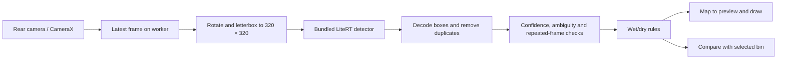

# How the application works

A camera frame is a picture in memory. CameraX supplies frames to one background worker, LiteRT runs the detector, and ordinary Kotlin code interprets its numbers. The main thread draws the newest useful result over the live preview.

| Component | Responsibility |
| --- | --- |
| `MainActivity` | Permission flow, approved screen text, scanner/bin selection, result display, license dialog and lifecycle. |
| `CameraController` | Binds the rear camera preview and analysis to one CameraX viewport. Starts/stops the worker and ignores callbacks from obsolete camera sessions. |
| `CameraAnalyzer` | Keeps analysis off the UI thread, accepts at most one frame every 180 ms, closes every ImageProxy in `finally`, and passes detections to the temporal filter. |
| `TrashDetector` | Checks the model's SHA-256, input/output shapes and float32 types, rotates and letterboxes the frame, runs two-thread CPU inference and restores boxes to camera-buffer coordinates. |
| `ModelContract` / `YoloDecoder` | Defines verified class order and tensor shape. Reads center coordinates and class scores, removes padding, clips boxes and calls class-aware non-maximum suppression. |
| `Geometry` | Small, Android-independent box, rotation and letterbox calculations. |
| `RecognitionFilter` | Requires confidence ≥ 0.60, class margin ≥ 0.15 and the same class at a nearby box in two consecutive analyzed frames no more than 700 ms apart. Conflicting overlapping classes remain uncertain. |
| `WasteRules` | Compares a confirmed wet/dry recommendation with the selected bin. It never maps an unknown detection to a guessed category. |
| `DetectionOverlay` | Draws confirmed purple boxes, wrong-bin orange boxes and uncertain gray dashed boxes. The text also distinguishes states, so color is not the only signal. |

## Coordinates without stretching

A 640×480 camera frame is not the same shape as a 320×320 model input or a tall preview. The app rotates the camera buffer upright, scales it uniformly, and adds gray padding to make a square. Decoding removes that padding and restores original image dimensions. It then undoes the sensor rotation. CameraX's `CoordinateTransform` maps the result from full buffer coordinates into the actual preview crop and rotation. Preview and analysis share a `ViewPort`, so they describe the same visible camera area. The rear camera is not mirrored.

Unit tests cover coordinate arithmetic. Android tests run the real detector with rotated images and check CameraX transforms, including center-crop and 90° rotation. They do not replace checking overlays on a real M51 camera.

## Responsiveness and uncertainty

`STRATEGY_KEEP_ONLY_LATEST` drops queued old frames rather than making the preview wait. Analysis has its own single worker; there are never several concurrent interpreter calls. Most model input/output arrays, the 320×320 bitmap and paint objects are reused. CameraX's image-to-bitmap conversion still allocates a frame bitmap, which is recycled after inference.

The 180 ms throttle is an upper limit of about 5.6 analyzed frames per second, not a promised phone frame rate. The preview runs independently. Results older than 900 ms are discarded, and displayed results expire. Rebinding the camera clears boxes immediately. Two-frame confirmation reduces flicker but does not prove a material is correct: a model can repeat the same confident mistake.

Closing or backgrounding the app stops camera use. Rebinding removes old camera-state observers. Opening Licenses pauses the camera; closing it resumes if the activity is active. Errors stop analysis and show only approved recovery text. No frame or result is written to storage.

## Suggested student review split

One student can explain the camera, permission flow and screen. The other can explain the model contract, decoder, confidence checks and bin rules. Together with the teacher, inspect one tensor fixture, follow one box through rotation/padding/crop, and run the tests before changing any threshold. The original upstream model was pretrained; no new training was performed for this app.
